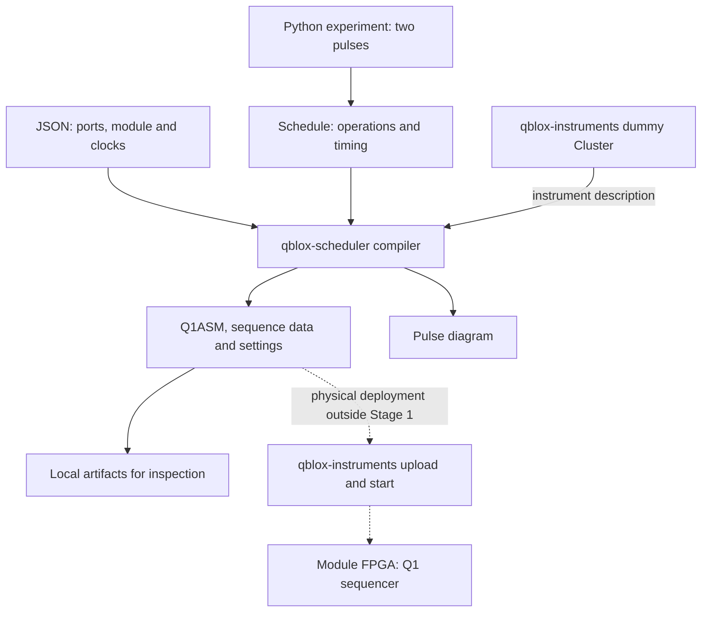

# Stage 1 architecture

## Experiment and schedule

The user defines the experiment in `build_schedule()` in
[`examples/dummy_cluster.py`](../examples/dummy_cluster.py). Two `SquarePulse`
operations specify normalized amplitudes, durations in seconds, a logical port
and a named clock. The second pulse begins 20 ns after the first pulse ends.
The intended envelope is 100 ns on, 20 ns off, 80 ns on.

A schedule is a description of operations and their time relationships. It does
not mean Python sleeps for 100 ns or toggles a physical output. `q0` is a logical
name here, not evidence that a qubit exists. This example starts at pulse level;
it does not translate quantum gates into calibrated pulses.

## Compilation and configuration

[`config/dummy_hardware.json`](../config/dummy_hardware.json) maps `q0:mw` to
`cluster0.module2.complex_output_0`. The target is a QRM-RF, a module capable of
output and acquisition; this exercise uses only its output. The logical clock
and local oscillator are both 5 GHz (zero intermediate frequency).

`HardwareAgent.compile()` resolves timing and the mapping to instrument
resources, then creates sequencer instructions and associated settings. This
turns the experiment's logical description into an instrument-specific program.
The resulting sequence includes Q1ASM text and waveform/acquisition tables;
module settings are also part of the compiled instructions. A sequence file alone
is not a complete physical-lab configuration. See the
[scheduler API](https://docs.qblox.com/en/main/autoapi/qblox_scheduler/index.html)
and [driver example](https://docs.qblox.com/en/main/quickstart/QBI_helloworld/qblox_instruments_helloworld.html).



## Responsibilities and execution boundary

`qblox-scheduler` is the experiment/compiler layer. `qblox-instruments` supplies
the driver API and dummy instrument implementation. Q1ASM is the instruction
language consumed by a module's sequencer, not another Python framework. The
official [starting tutorial](https://docs.qblox.com/en/main/quickstart/QBS_helloworld/qbloxscheduler_helloworld.html)
selects a dummy Cluster with `ip=None`; JSON represents this as `null`.

On physical hardware the sequencer resides in the module FPGA. Its Q1 core
handles program logic and queues real-time instructions; its RT core applies
timed actions to the signal path. Host-side Python handles experiment setup,
compilation and orchestration under the host OS. A Windows process is not the
nanosecond timing source for an uploaded sequence. This is analogous to a host
preparing a control trajectory for a dedicated controller. See
[Q1 sequencer architecture](https://docs.qblox.com/en/main/products/architecture/sequencers/sequencer.html).

## Validation boundary

The dummy Cluster substitutes the driver's instrument connection. It is not a
qubit physics model, analog circuit simulator or cycle-accurate FPGA simulator.
This script compiles only: it does not upload, arm, start or acquire. Consequently,
success means this pinned software stack accepts the description and generates
the inspected artifacts. It does not prove that a physical sequencer executed
the program or that firmware accepted it.

| Can check here | Requires a physical setup or a separate validated model |
| --- | --- |
| API compatibility and configuration acceptance | Actual module/firmware compatibility and upload |
| Resolved pulse timings and generated program structure | Measured timing, synchronization and runtime error flags |
| Logical-to-physical mapping in compiler output | Cable routing, attenuation, mixer calibration and signal integrity |
| Requested pulse envelope diagram | Oscilloscope traces, noise, qubit response and readout fidelity |

The pulse plot is calculated from the compiled schedule, not captured from an instrument.
There are no acquisitions or measurement results. Normalized pulse amplitudes
do not establish physical voltage or power. Compiler setup/trailer instructions
may extend the sequence beyond the 200 ns experiment span.

## Annotated generated Q1ASM

This excerpt was generated by scheduler 1.0.1 with instruments 1.4.1 on
2026-11-17. Comments below explain the output; the complete unedited program is
saved as `artifacts/stage1/cluster0_module2_seq0.q1asm`.

```text
set_awg_offs 16384,0  # Request normalized I offset 0.5; Q offset 0.
upd_param 96         # Apply the offset and advance real-time execution by 96 ns.
set_awg_offs 0,0     # Clear the offset when the following play applies it.
set_awg_gain 16384,0 # Scale waveform 0 to I amplitude 0.5; Q contribution 0.
play 0,0,24          # Play a 4-sample waveform; next RT instruction is 24 ns later.
set_awg_gain 8192,0  # Scale waveform 1 to I amplitude 0.25.
play 1,1,80          # Play an 80-sample waveform and advance by 80 ns.
```

This is a concrete lowering decision: the first 100 ns square pulse becomes a
96 ns offset followed by a 4 ns waveform. The remaining 20 ns of `play ... ,24`
is the requested gap. A `play` duration is the delay to the next real-time
instruction; it is not necessarily the length of the referenced waveform.
Relative to the first pulse, the second starts at 96 + 24 = 120 ns and ends at
200 ns. The sequence's
waveform tables contain unit-valued samples; the integer gains supply the desired
amplitudes. Both paths may reference the same waveform index, with Q gain zero.
See the [Q1ASM guide](https://docs.qblox.com/en/main/products/qblox_instruments/q1/index.html)
for gain, offset, update and playback semantics.

Before this excerpt the compiler inserts marker setup, synchronization, phase
reset and loop setup; after it the program exits its single repetition and stops.
Do not add all host-side instruction execution times to infer the pulse timing:
Q1 logic and RT execution are separate. The tests intentionally bind to this
compiler version's lowering; a version upgrade must re-evaluate these assumptions.

The exported timing table includes a compiler-added 4 ns phase-update interval.
Thus the plot's first pulse starts at 4 ns and the second at 124 ns, ending at
204 ns. Relative to the first pulse they still start at 0 and 120 ns. The offset
changes appear as zero-duration events at 4 and 100 ns; the remaining waveform
segments start at 100 and 124 ns. These timing-table coordinates do not include
every Q1ASM startup instruction, and are not measurements of hardware latency.

## Failure cleanup

The script records the existing QCoDeS instrument registry before constructing
the HardwareAgent. Its `finally` block discovers newly registered Clusters and
coordinator components even when initialization or connection fails. It attempts
every close independently. If the main operation failed, that exception remains
primary and cleanup failures appear as exception notes; otherwise cleanup errors
are raised together. Existing instruments are preserved, including refusal to
replace an existing `cluster0`.

This small lifecycle policy relies on the pinned QCoDeS 0.63.0 registry and a
single-threaded standalone script. It does not manage vendor-internal resources
that fail before registration. No generalized backend/resource framework is added.
